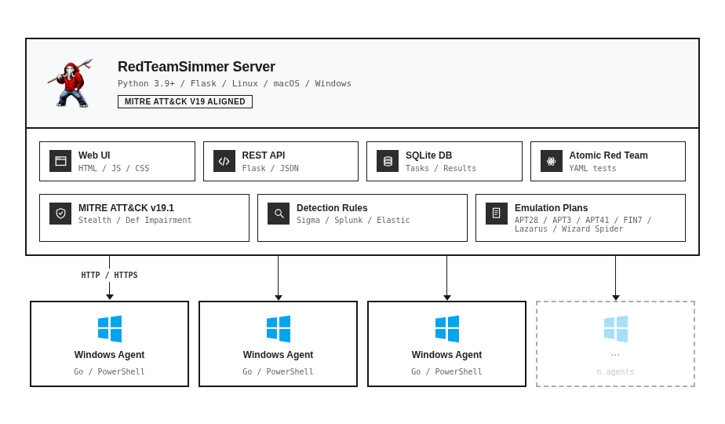
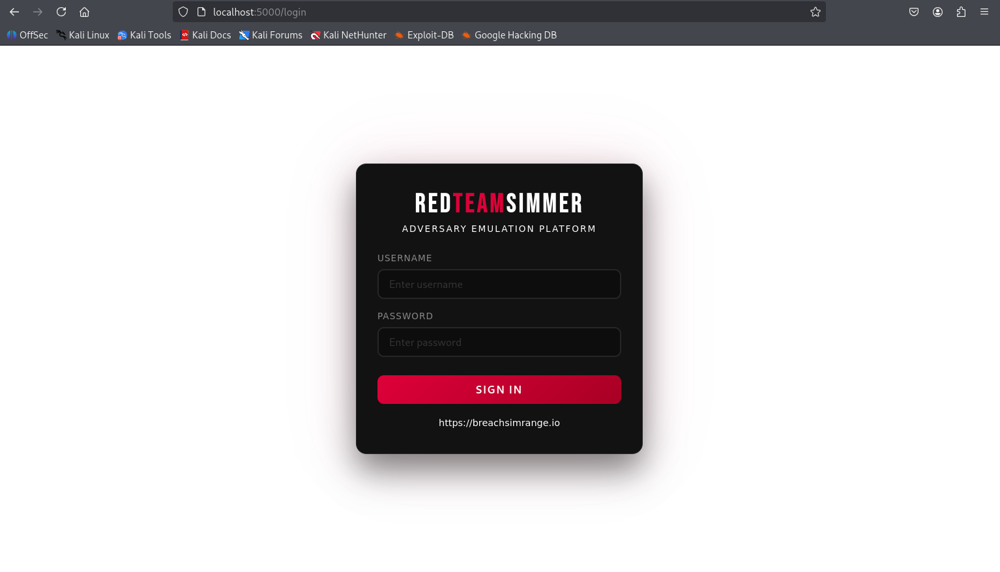
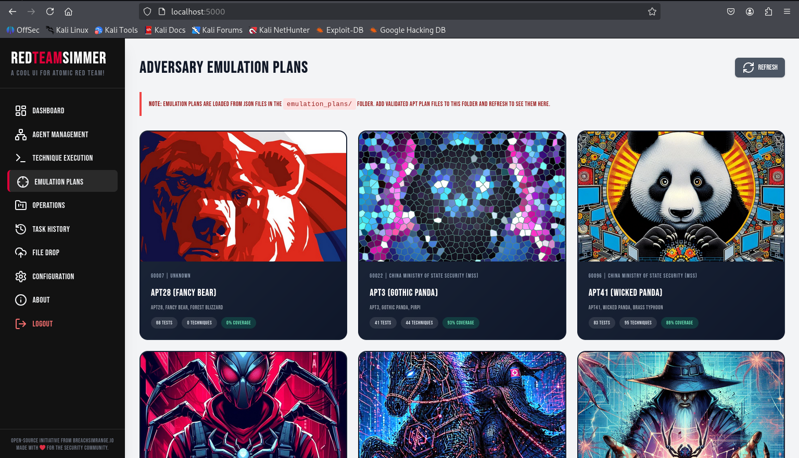

<p align="center">
  
</p>

<h1 align="center">RedTeamSimmer</h1>

<p align="center">
  <strong>The UI You've Always Wanted for Atomic Red Team</strong><br>
A Web Based Adversary Emulation Platform and Atomic Red Team Test Orchestration.
</p>

<p align="center">
  <a href="https://github.com/breachsimrange/redteamsimmer/releases"></a>
  <a href="https://github.com/breachsimrange/redteamsimmer/blob/main/LICENSE"></a>
  <a href="https://attack.mitre.org/resources/updates/updates-april-2026/"></a>
  <a href="https://www.python.org/"></a>
  <a href="https://go.dev/"></a>
  <a href="https://github.com/breachsimrange/redteamsimmer/stargazers"></a>
  <a href="https://x.com/breachsimrange"></a>
</p>

---

## Overview

**RedTeamSimmer** is an open-source, web based adversary emulation platform providing a modern UI for orchestrating Atomic Red Team tests across enterprise Windows environments. It was initially created for 'Mastering Breach and Adversarial Attack Simulation' training at DEF CON Trainings. Traditional atomic tests execution demands memorizing PowerShell syntax, manually managing prerequisites per endpoint, and collecting scattered results with no centralized visibility. RedTeamSimmer solves this with a Flask server, lightweight Golang agents, and a real-time web interface enabling security teams to execute MITRE ATT&CK mapped techniques in few clicks. Operators deploy agents to multiple endpoints, browse the full ATT&CK catalog, run tests with automatic prerequisite handling, and monitor live color-coded output from a single dashboard. 

RedTeamSimmer bridges the gap between complex adversary emulation tooling and practical usability - giving you the power of Atomic Red Team with a clean, intuitive interface.

It also ships with adversary emulation plans modelled using Atomic Red Team for real threat actors including APT28, APT3, APT41, FIN7, Lazarus Group, and Wizard Spider for multi-stage attack simulations. Detection rule mappings for Sigma, Splunk, and Elastic Security help blue teams identify coverage gaps and validate alerting. A full operations history provides a complete audit trail for compliance. Designed for red teamers, blue teamers, purple team exercises, EDR/AV testing, and training.

RedTeamSimmer is created and maintained by the [BreachSimRange](https://breachsimrange.io) team. The original RedTeamSimmer was created by @abhijithbr. [@abhijithbr](https://x.com/abhijithbr) 

---

## Presented At

RedTeamSimmer has been presented at the following security conferences, where the platform's adversary emulation capabilities and live atomic test execution were demonstrated to the community:

- **DEF CON Singapore 2026 Demo Labs** - first public presentation
- **Black Hat USA 2026 Arsenal**
- **Black Hat Europe 2026 Arsenal** - upcoming

---

## Features

### MITRE ATT&CK Integration

RedTeamSimmer organizes all atomic tests by MITRE ATT&CK tactics, making it easy to navigate and select techniques for execution.

- **Tactic-Based Navigation** - Tests are grouped under their respective MITRE ATT&CK v19 tactics (Initial Access, Execution, Persistence, Privilege Escalation, Stealth, Defense Impairment, Credential Access, Discovery, Lateral Movement, Collection, Command and Control, Exfiltration, Impact). v19 (April 2026) split the legacy Defense Evasion tactic into Stealth (TA0005) and Defense Impairment (TA0112) - see [docs/UPDATES.md](docs/UPDATES.md) for the full migration notes.
- **Technique Details** - View full technique descriptions, supported platforms, executor types, and elevation requirements before execution
- **Sub-Technique Support** - Properly handles sub-techniques (e.g., T1059.001 PowerShell under T1059 Command and Scripting Interpreter)
- **ATT&CK Links** - Direct links to MITRE ATT&CK documentation for each technique

### Multi-Agent Architecture

Deploy lightweight agents on target systems and orchestrate test execution remotely from the central server.

- **Go-Based Agent** - Compiled, standalone binary with no external dependencies
- **Agent Registration** - Agents automatically register with the server and report system information (hostname, username, OS, architecture)
- **AV Detection** - Agents detect 60+ antivirus/EDR products including CrowdStrike, SentinelOne, Carbon Black, Defender, and more
- **Configurable Polling** - Adjustable poll intervals and jitter timing for stealth
- **Startup Persistence** - Optional persistence via registry, scheduled tasks, or startup folder
- **Remote Shutdown** - Clean agent removal with full artifact cleanup

> **Note:** Currently only **Windows agents** are fully supported. Linux/macOS agent support is planned for future releases.

### Live Execution Output

Test output streams in real time as the agent executes, not after completion, so you can watch prerequisites run, the main command fire, and cleanup trigger as it happens. Output types - stdout, stderr, and agent messages - can be toggled independently to cut noise. Each test phase is separated by decorative log banners, timed individually, and the exit code surfaces immediately on completion.

### Prerequisite Management

Atomic tests often need tools or files in place before they execute. RedTeamSimmer parses the YAML test definition, runs the `prereq_command` to check whether dependencies are already satisfied, and if not, runs `get_prereq_command` to install them. A re-verification step confirms the prerequisites are in place before the main command fires. If you want to skip this - for example when you have already staged the target - the UI exposes a manual override to run the test directly.

### Threat Actor Emulation Plans

RedTeamSimmer ships with pre-built emulation plans modelled on real-world APT tradecraft. Each plan chains together Atomic Red Team tests mapped to the techniques documented in the corresponding MITRE ATT&CK group profile, so you execute the actor's kill chain in sequence rather than running isolated techniques. Plans are JSON-defined, fully editable, and extensible - you can modify ordering, add or remove techniques, or build your own from scratch using the custom plan builder.

**Included Plans:**

| Threat Actor | Origin | Focus |
|--------------|--------|-------|
| **APT28 (Fancy Bear)** | Russia - GRU Unit 26165 | Government espionage, election interference, credential harvesting |
| **APT3 (Gothic Panda)** | China - MSS | Aerospace, defence, and telecom targeting |
| **APT41 (Wicked Panda)** | China - dual-use | Hybrid espionage and financially motivated intrusions |
| **FIN7 (Carbanak)** | Financially motivated (eCrime) | POS malware, retail and hospitality breach patterns |
| **Lazarus Group** | North Korea - RGB | Financial theft, destructive attacks, cryptocurrency operations |
| **Wizard Spider** | Financially motivated (eCrime) | Ryuk/Conti ransomware kill chains, credential access, lateral movement |

Each plan includes the attack chain ordering, `-GetPrereqs` flags for test dependencies, and MITRE technique IDs for ATT&CK Navigator layer export. Execution runs techniques sequentially across one or more agents with full output captured per step.

### Dashboard & Reporting

The dashboard gives you a single view of active agents with online/offline status, total emulations executed, technique coverage count, success and failure statistics, recent task history, and a failed operations list for quick triage.

Three chart types visualise the operational picture - a doughnut chart for task status distribution, a bar chart for tactic coverage, and a pie chart for agent status breakdown.

The MITRE ATT&CK Heatmap renders executed techniques against the ATT&CK matrix with colour-coded status (completed, failed, running, pending), click-through to detailed output, and live updates as operations progress.

### View Details Modal

The details modal is where you drill into a single technique execution. The execution summary shows the technique ID, exit code, and duration at a glance, followed by a parsed breakdown of test name, description, executor, and platform. Input arguments are displayed in both their raw form (with variable placeholders) and resolved form (with actual values), so you can see exactly what ran. The prerequisite, main command, and cleanup sections each display their own output streams with syntax highlighting. Cleanup commands are shown for reference but not auto-executed. External links route to MITRE ATT&CK, SigmaHQ, and the Atomic Red Team repository for further investigation.

### Detection Rules Integration

Every executed technique is correlated against detection rules from three sources:

- **Sigma Rules** - generic detections convertible to any SIEM format
- **Splunk Queries** - ready-to-use SPL queries
- **Elastic Rules** - detections for Elastic Security

Rules are matched automatically against the technique ID, with a count summary per technique and expandable views for full query content. Direct links route to the upstream rule repositories. The rule database is local and offline, so no external API calls fire during execution - useful when running in restricted or air-gapped environments.

### Operations Management

The operations view lists every operation with status, progress, and timestamps. Running operations can be paused, resumed, or stopped from the interface. Progress is shown as a percentage completion bar, and clicking into any operation opens the full execution timeline with a per-technique results table (status, duration, exit codes) and a filterable log view for debugging specific runs.

### File Drop System

When an emulation requires specific technique folders on the target, the server bundles them into a ZIP archive and distributes to the selected agents. Agents confirm successful extraction before execution begins, and the staged files are removed after the test completes or when the agent shuts down cleanly.

### Agent Management

The agent list shows every registered agent with status indicators alongside hostname, username, OS, architecture, and last-seen time. AV detection results are displayed per agent so you can see exactly which security products are installed on the target. Agent configuration - startup persistence, jitter timing, metadata - can be modified from the UI without redeploying the binary. The remote shutdown action cleanly removes the agent along with its artifacts: registry entries, scheduled tasks, and dropped files.

---

## Architecture



---

## Documentation

Detailed guides live in separate files:

- **[Installation](docs/INSTALLATION.md)** - prerequisites, Docker and direct setup, Go toolchain, agent build, detection rules, and PowerShell modules.
- **[Quick Start](docs/QUICKSTART.md)** - start the server, log in, deploy an agent, and run your first test.
- **[Deployment](docs/DEPLOYMENT.md)** - running the server as a systemd service.
- **[Configuration](docs/CONFIGURATION.md)** - server and agent settings, and production TLS.
- **[Troubleshooting](docs/TROUBLESHOOTING.md)** - common issues and fixes.
- **[Contributing](CONTRIBUTING.md)** - how to contribute, development setup, and code style.
- **[Recent Updates](docs/RECENT_UPDATES.md)** - MITRE ATT&CK v19.1 migration summary (full notes in [docs/UPDATES.md](docs/UPDATES.md)).

---

## Screenshots

<details>
<summary>📸 Click to expand screenshots</summary>

### Login


### Emulation Plans



</details>

---

## Contributors

<table>
  <tr>
    <td align="center">
      <strong>Abhijith "Abx" B R</strong><sub>Author and Project Lead</sub><br>
      <a href="https://github.com/abhijithbr">GitHub</a> •
      <a href="https://twitter.com/abhijithbr">Twitter</a> •
      <a href="https://linkedin.com/in/abhijith-b-r">LinkedIn</a>
    </td>
  </tr>
</table>

*Want to see your name here? [Contribute to the project!](CONTRIBUTING.md)*

---

## Author and Organization

### Abhijith "Abx" B R

Security researcher and passionate about building tools for the offensive cybersecurity community. Founder of [BreachSimRange](https://breachsimrange.io) and [Adversary Village](https://adversaryvillage.org).

### BreachSimRange

[BreachSimRange](https://breachsimrange.io) is an offensive security consulting and training company. Our mission is to simplify offensive cyber security operations and breach simulation, ensuring effortless cyber security solutions for all. Trust us to make your cyber defenses stronger, easier, and more effective. 

---

## Acknowledgments

- [Atomic Red Team](https://github.com/redcanaryco/atomic-red-team) by Red Canary - The foundation of this platform
- [MITRE ATT&CK](https://attack.mitre.org/) - Framework for adversary tactics and techniques
- [SigmaHQ](https://github.com/SigmaHQ/sigma) - Generic detection rules
- [Elastic Detection Rules](https://github.com/elastic/detection-rules) - Elastic Security rules
- [AttackRuleMap](https://github.com/krdmnbrk/AttackRuleMap) - ATT&CK to detection rule mapping

---

## Disclaimer

**This tool is intended for authorized security testing and educational purposes only.**

Unauthorized access to computer systems is illegal. Always obtain proper authorization before conducting any security assessments. The author and BreachSimRange are not responsible for misuse of this tool.

---

## License

RedTeamSimmer is licensed under the **GNU General Public License v3.0 (GPLv3)**.

```
Copyright (C) 2026 BreachSimRange

This program is free software: you can redistribute it and/or modify
it under the terms of the GNU General Public License as published by
the Free Software Foundation, either version 3 of the License, or
(at your option) any later version.

This program is distributed in the hope that it will be useful,
but WITHOUT ANY WARRANTY; without even the implied warranty of
MERCHANTABILITY or FITNESS FOR A PARTICULAR PURPOSE. See the
GNU General Public License for more details.

You should have received a copy of the GNU General Public License
along with this program. If not, see <https://www.gnu.org/licenses/>.
```

See the [LICENSE](LICENSE) file for the full license text.

### What GPLv3 Means for You

- **Free to use, modify, and self-host** for any purpose, including commercial internal use
- **Modifications must be shared** under GPLv3 if you distribute the software
- **Cannot be combined with proprietary code** in a distributed product
- **Patent grant** - contributors grant patent rights for the code they contribute
- **No warranty** - the software is provided as-is


### Contributor License Agreement

Contributions to RedTeamSimmer require signing a Contributor License Agreement (CLA). The CLA grants BreachSimRange the right to use contributed code under both GPLv3 and the commercial license. This keeps the project sustainable and allows the dual-licensing model to work.

The CLA is signed automatically via **CLA Assistant** on your first pull request - no separate paperwork required.

**Third-Party Licenses:**
- [Atomic Red Team](https://github.com/redcanaryco/atomic-red-team) - MIT License (Red Canary)
- [Invoke-AtomicRedTeam](https://github.com/redcanaryco/invoke-atomicredteam) - MIT License (Red Canary)

---

<p>
  <strong>Version 1.0.1</strong><br>
  Made with ❤️ for the security community.
</p>

